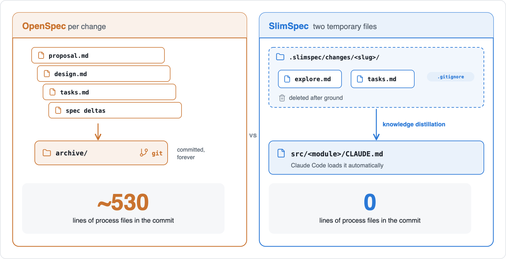
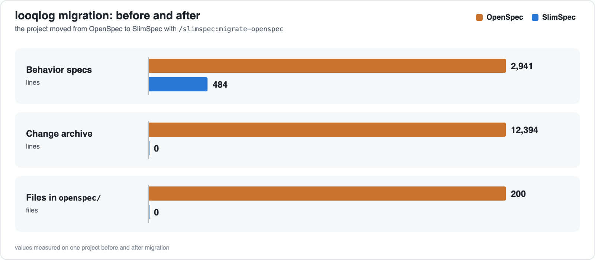
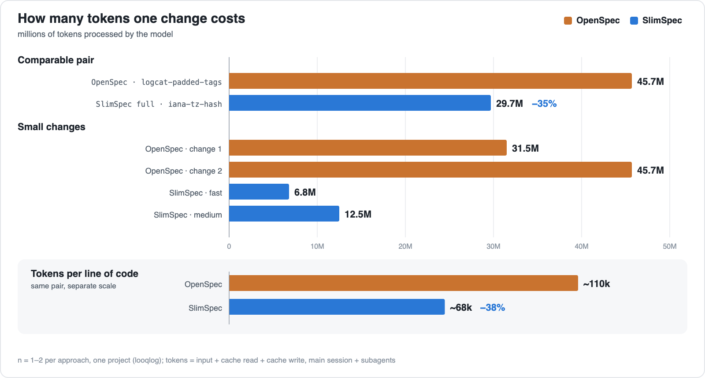
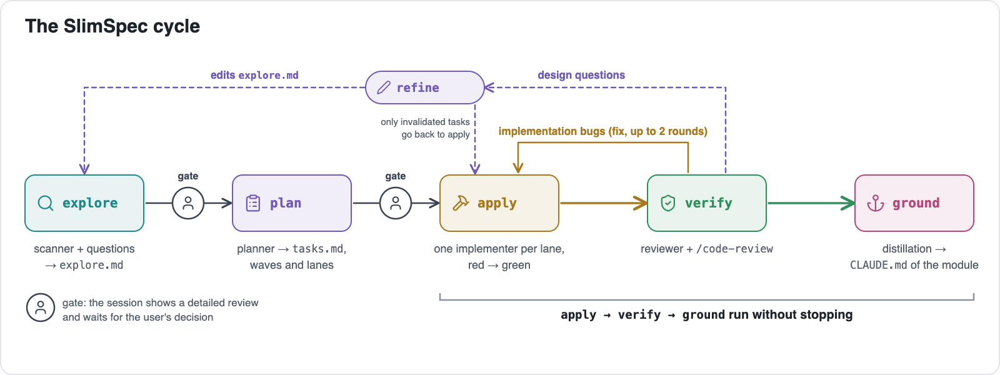
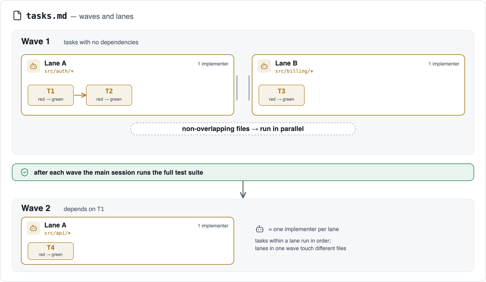
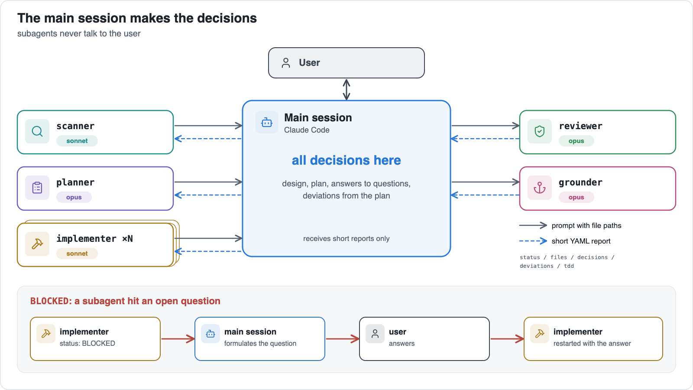
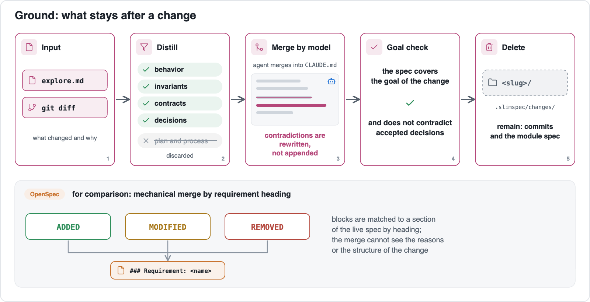

# SlimSpec

Website: https://yushman.github.io/slimspec/

[Русская версия](README.ru.md)

## Strong models don't need heavy specs.

An agent rebuilds the picture by scanning the code, and it does that fast. A spec only has to tell it what to do and where to look. The explore step already is the spec of a change.

**SlimSpec** is a Claude Code plugin built on that. It runs the explore → plan → apply → verify loop with mandatory red-green TDD. A change uses two temporary files. Each module has one compact spec in a nested `CLAUDE.md`, which Claude Code loads automatically: where to look and what must not break, nothing else.

Call it spec-driven development in reverse. The spec doesn't drive the work; the work leaves a spec behind on its way out.

## Install

In Claude Code:

```
/plugin marketplace add yushman/slimspec
/plugin install slimspec@slimspec
```

Then: `/slimspec <idea>`

Or load a local clone:

```bash
git clone https://github.com/yushman/slimspec ~/src/slimspec
claude --plugin-dir ~/src/slimspec/plugin
```

Inside there are only skills and agent definitions. No scripts, no hooks, no CLI, so there isn't much left to break.

## Why

Spec-driven development made sense when models were weaker. Context was small, there were no subagents, and every new session started like a new hire who skipped onboarding. So you wrote everything down, committed the paper, and the next session read it. OpenSpec and Superpowers came out of that era, and their best idea, design before plan, is still here.

Then came a change in a project with no SDD framework at all. No proposal, no design, no delta specs, not even a modest `tasks.md` in the corner. The model read the code, found the places to touch, made the change, and it passed human review by the code owner. Not a single spec involved.

Compare that with a team project on OpenSpec, where the flow stayed slow even with a corporate subscription and several terminals running different features at once:

- After the proposal come design, tasks, delta specs and the rest. Nobody really read them. They were still written, committed and archived, like TPS reports with a fresh cover sheet.
- Any edit to an unarchived change becomes another change. Changed your mind halfway? Please file a new form.
- Archiving needs a rebase, and then someone has to ask the agent to check the spec merge by hand, because another teammate may have touched the section a MODIFIED block lands in.

The record for paperwork: removing a feature, an unneeded piece of a screen. A deletion task, the easiest kind there is. Delete the code, delete the tests, close the ticket. The final diff:


About 5,500 lines went out and almost as many came in. The newcomers were specs: a proposal on why to delete, a design on how to delete, tasks on the order of deletion, and REMOVED deltas on what exactly was deleted. Deleting ~5k lines of code took writing ~5k lines of specs. Kafka would have found it a bit much.

In **SlimSpec** the main session already is the design. You talk the change through with the agent, and the design and plan appear right there. Deviations are recorded in the same place, no new change needed; if a follow-up grows, the agent offers to move it out of scope into non-goals. The files exist only in case the session gets lost or compacted. They are a save point, not the game.



## Measured on a real project

### Migration

One existing project, [looqlog](https://github.com/yushman/looqlog), a Rust + web log viewer, was moved from OpenSpec with `/slimspec:migrate-openspec`. It had 23 spec files, 23 archived changes, 200 files in `openspec/` and 733 KB of history. Not that the agent needed all of it, but once you get into a serious artifact collection, the tendency is to push it as far as you can. Before and after:

|                       | OpenSpec                                    | **SlimSpec**                    |
|-----------------------|---------------------------------------------|-----------------------------|
| Behavior specs        | 23 files, 2,941 lines, ~155 KB              | 3 files, 484 lines, ~34 KB  |
| Change archive        | 23 changes, 12,394 lines, ~733 KB           | 0                           |
| Root `CLAUDE.md`      | 130 lines                                   | 121 lines                   |
| Files in `openspec/`  | 200                                         | 0                           |



### Where the size went

- WHEN/THEN scenarios were folded into the requirements they describe. Empty Purpose sections and SHALL boilerplate are gone (SHALL, SHALL NOT, SHALL ALWAYS: the specs had started to read like terms of service).
- One spec per module instead of 23 per feature. The agent reads only the spec of the module it works in: an edit in `web/` pulls ~11 KB, not a set of capability files scattered across the tree.
- The change archive is out of the working tree. It is still in that project's git history.

### What was lost

Every diet has side effects:

- Scenarios no longer exist as a list of test cases.
- Per-change rationale is gone. Part of it lives on in ADRs; the rest is only in git history, for anyone who enjoys `git blame` as a hobby.
- The largest module spec (~14 KB) is loaded whole for any work in that module.

Four **SlimSpec** changes later the module specs are 4 files and 641 lines, still 78% below the OpenSpec specs they replaced. Growth now tracks the code, not the ceremony.

### Cost per change

The same project, before and after the migration, measured from Claude Code transcripts. Tokens are all input the model processed (input + cache read + cache write), main session and subagents together. The closest pair in size:

|                                  | OpenSpec (`logcat-padded-tags`) | **SlimSpec** full (`iana-tz-hash`) |
|----------------------------------|---------------------------------|--------------------------------|
| Code changed                     | 409 lines, 4 files, one module  | 435 lines, 15 files, three modules |
| Tokens processed                 | 45.7M                           | **29.7M (−35%)**               |
| Tokens per changed code line     | ~110k                           | **~68k (−38%)**                |
| Review                           | none                            | **2 verify rounds at depth high; one real blocker (panic on extreme dates) fixed inside the change** |
| Process files committed          | ~530 lines (proposal, design, tasks, delta specs, devlog) | **0** (change folder deleted; spec updates live in the module `CLAUDE.md` files) |
| Wall-clock span, gates included  | 91 min                          | 56 min                         |



The **SlimSpec** run also did more: 5 decision questions and 3 gates, 9 tasks in 3 waves, ground into 4 specs, an ADR and both READMEs. The blocker the reviewer caught was a panic on extreme dates, the kind that sits quietly until the calendar does something unusual.

Smaller changes point the same way. Two OpenSpec changes processed 31.5M and 45.7M tokens; two **SlimSpec** changes (fast and medium) 6.8M and 12.5M. One OpenSpec implementer alone processed 13–16M tokens; a **SlimSpec** subagent 0–1M, because each gets one narrow lane and doesn't have to hold the whole repo in its head.

Caveats, up front: n = 1–2 per flow, one project. The small **SlimSpec** changes were 5–10× smaller in code, so part of that gap is size. Some **SlimSpec** agents ran on Sonnet or Haiku. The **SlimSpec** full run's main session carried earlier unrelated context, which inflates its count. Small sample, big gap: an observation, not a benchmark.

## The flow



`refine` patches `explore.md` and `tasks.md` and sends invalidated tasks back to `apply`. It starts from design findings in verify or from an apply task blocked because the design or plan is wrong.

- `explore`: A scanner reads module specs, then code, and returns a short brief. The main session asks you questions (one decision per question, independent ones together) and writes `explore.md`. It never moves on to a plan by itself. Expect your own idea to get more pointed questions than you planned for; that's the point.
- `plan`: A planner writes `tasks.md` in waves and groups each wave into lanes of related tasks. Lanes in one wave touch disjoint files and run in parallel. Each task names its first failing test.
- `apply`: One implementer per lane works through its tasks in order, with red-green evidence for each. The full suite runs after each wave, so lanes that pass on their own can't fail together unnoticed. A task blocked by the design or plan (a missing decision, wrong files, infeasible as planned) goes to you through `refine`, then apply continues.
- `verify`: A reviewer checks plan and design conformance, TDD evidence and the code. Bugs go back to apply; design issues go to you through `refine`.
- `ground`: Durable knowledge (behavior, invariants, contracts, decisions) is distilled and merged into the touched module specs by the model, not by keywords. Then the change folder `.slimspec/changes/<slug>/` is deleted (or archived, see Config); `.slimspec/` and its config stay.



You stop twice: after explore and after plan. Each stop opens with a detailed walkthrough: the design with diagrams after explore, the full plan (waves, lanes, tests per task) after plan. The remaining phases run without stopping and return to you only for agent questions, design findings, or after two automatic fix cycles. This is the part where you can go do something else.

All decisions are made in the main session. Subagents execute and return a short structured report (status, files, decisions, deviations, red/green evidence). They never ask you directly: an open question comes back as `BLOCKED`, the main session asks you and relaunches the agent with the answer. A report looks like this, with no logs and no diffs:

```yaml
status: DONE | BLOCKED | FAILED
task: T3
files: [src/auth/token.ts, src/auth/token.test.ts]
decisions: ["used existing clock abstraction"]
deviations: ["renamed validate → verifyToken"]
tdd:
  red: "token.test.ts: rejects expired token — FAIL (expected 401, got 200)"
  green: "12 passed"
questions: []
```

The main session's context stays clean of test-log walls, yet it holds every decision and every outcome.



A change lives in `.slimspec/changes/<slug>/` as `explore.md` and `tasks.md`. By default the folder is gitignored (**SlimSpec** adds `.slimspec/changes/` to `.gitignore`) and removed after ground; the history is your commits and the updated specs. It goes quietly: anything worth keeping has already moved into the specs. `/slimspec <slug>` resumes a change from its files.

Ground is the one part that still feels like classic SDD. The plan and the process are dropped; nobody will ever need to know which wave T3 was in. What survives is merged by an agent that understands why the change was made. A statement that contradicts the change gets rewritten instead of getting a new neighbour, otherwise the spec slowly becomes a comment thread arguing with itself. Then the agent checks that the updated spec covers the change's goal and doesn't argue with its decisions. The result lands in the module's nested `CLAUDE.md`, so the next agent that walks into that module finds the spec already waiting.



TDD is enforced by red/green evidence in every mode; there is no TDD hook. Implementers run only their task's tests; the full suite runs once after each wave and once more in verify. Verify won't accept a task without a red run, and the red has to fail for the right reason: a test that fails on a missing import proves nothing. You shall not pass. Where TDD doesn't apply (config, styles, migrations), a task says `test: none — <reason>` with an alternative check, and every such exemption is listed at the plan gate, so "tests aren't needed here" can't hide in the middle of the list.

## Modes

| Phase     | fast                                   | medium                          | full                                          |
|-----------|----------------------------------------|---------------------------------|-----------------------------------------------|
| `explore` | inline, ≤3 questions, merged with plan | scanner + grilling              | same + explicit gate on `explore.md`          |
| `plan`    | section inside `explore.md`            | planner agent, waves of lanes   | same + full `tasks.md` at the gate            |
| `apply`   | one implementer, TDD                   | one implementer per lane        | same                                          |
| `verify`  | reviewer, depth `low`                  | reviewer, depth `medium`        | reviewer, depth `high`                        |
| `ground`  | update touched specs                   | distill + intent check          | same                                          |

`fast` is for the one-line fix you'd be embarrassed to write a proposal for. `full` is for the change you want a second pair of eyes on. Don't want to choose? `/slimspec` suggests a mode after the scan.

The planner splits each wave into lanes of related tasks with disjoint files; apply runs one implementer per lane, up to `apply.agents` in parallel, each working through its tasks in order.

```
/slimspec <idea>          # mode from config, suggested after the scan
/slimspec:fast <idea>     # fixed mode, no suggestion
/slimspec:medium <idea>
/slimspec:full <idea>
/slimspec:debug <bug>     # root cause first, then plan → apply → verify → ground
/slimspec                 # list active changes: resume or abandon
```

`/slimspec:debug` replaces explore for bugs. A debugger agent reproduces the bug, tests one hypothesis at a time and returns the root cause with evidence; it never fixes anything. The main session turns that into `explore.md`, with the repro as the first failing test, and the cycle goes on from the gate. A leading `fast`, `medium` or `full` pins the mode.

Each phase is also a command of its own: `/slimspec:explore`, `/slimspec:plan`, `/slimspec:apply`, `/slimspec:verify`, `/slimspec:refine`, `/slimspec:ground`.

## Compared with OpenSpec and Superpowers

**SlimSpec** reuses parts of both: design before plan from both, and a spec merge that keeps only what matters from OpenSpec. The table lists only the points where **SlimSpec** differs; the bold part of each **SlimSpec** cell is what it does better.

|                       | OpenSpec | Superpowers | **SlimSpec** |
|-----------------------|----------|-------------|----------|
| Flow                  | explore → propose → apply → verify → archive, a command per step; explore and verify are optional | brainstorming → worktree → plan → execute → finish branch; skills trigger on their own | **One command, two stops.** It runs explore → ground; you stop at two gates; verify is never skipped |
| Explore               | `/opsx:explore`, an optional thinking partner before a proposal | brainstorming; once a project's design is approved, the next step is a plan | **Explore is the spec of the change.** Grilling, one decision per question, writes `explore.md` (goal, non-goals, decisions, risks); no separate proposal or design |
| Artifacts per change  | proposal, design, tasks, delta specs; the folder then moves to an archive in the repo | for a project: a dated design doc in `docs/superpowers/specs/` (committed) and a plan in `docs/superpowers/plans/`; small changes stay in chat | **Nothing to commit but code and spec edits.** `explore.md` + `tasks.md`, gitignored, deleted after ground |
| Living spec           | one file per capability under `openspec/specs/`, read when you point the agent at it | none; one design doc per project | **Loaded on its own, only where you work.** One spec per module as a nested `CLAUDE.md` |
| Spec merge            | ADDED / MODIFIED / REMOVED sections applied to the main spec, requirement by requirement, at archive | no merge into a living spec | **Merged by meaning.** The model rewrites contradictions and checks the result against the change's intent |
| Subagents             | no built-in subagent mechanism | a fresh subagent per task with a review after each, or inline execution | **Narrow agents, cheap context.** Scanner, debugger, planner, parallel implementers per lane, reviewer, grounder, each on its own model; questions bubble up to you |
| Measured cost         | 45.7M tokens for a ~400-line change | not measured | **29.7M tokens for a comparable change, with two review rounds** |

**What SlimSpec does not have.** OpenSpec keeps scenarios as explicit test cases and a full history of every change next to the specs, and it works with 30+ AI tools. Superpowers has skills outside the spec flow (worktrees, code review and others) and supports many coding agents. **SlimSpec** works only with Claude Code and covers only the spec-driven loop. It runs one loop and stays in its lane.

## Migrating from OpenSpec or Superpowers

```
/slimspec:migrate-openspec     # openspec/specs/ → module specs
/slimspec:migrate-superpowers  # Superpowers design docs → module specs
```

- Specs only. Each source spec is mapped onto modules, distilled into your `spec.format` and checked against the code.
- You approve a source → spec table first, and decide on every statement the code disagrees with. Either side can be wrong, and the tool won't pick a winner for you.
- Changes, plans and tooling are not converted. They are deleted only at a final cleanup step, and only what you confirm. Code is never touched.
- Remove the Superpowers plugin itself with `/plugin uninstall`.

## Config

Optional. Without a config every key has a default; if you don't want to configure anything, don't. `/slimspec:init` asks a few questions in the session and writes `.slimspec/config.yaml`:

```yaml
mode: medium              # fast | medium | full
spec:
  format: claude-md       # claude-md | readme | central | native | none
  unit: auto              # auto (by build files) | dir glob, e.g. "src/*/"
  adr: false              # also keep decisions in docs/adr/NNNN-*.md
test: auto                # or an explicit command
commit: none              # none | lane | wave
changes:
  closed: delete          # delete | archive (.slimspec/archive/<date>-<slug>/)
  gitignore: true         # add .slimspec/changes/ and .slimspec/archive/ to .gitignore
apply:
  agents: 3               # max parallel implementers = max lanes per wave
review:
  depth: auto             # auto (by mode) | low | medium | high
models: {}                # per-role overrides, see below
```

`changes` decides what happens to change folders. `closed: archive` makes ground move a closed change to `.slimspec/archive/<date>-<slug>/` instead of deleting it; archived changes are never listed or resumed. `gitignore: false` leaves `.gitignore` alone, so with `commit: lane` or `wave` the change files go into the lane or wave commits, and ground commits their deletion or move together with the spec edits.

`models` sets the model of each phase's agent, keyed by role: `haiku | sonnet | opus`. Keys you leave out keep their defaults.

| Phase | Role (`models` key) | Default |
|---|---|---|
| explore (medium, full) | `scanner` | sonnet |
| debug | `debugger` | opus |
| plan (medium, full) | `planner` | opus |
| refine (structural replanning, medium, full) | `planner` | opus |
| apply | `implementer` | sonnet |
| verify | `reviewer` | opus |
| ground | `grounder` | opus |

Questions, gates, triage and the rest of refine run in the main session, on your session's model. `fast` explores and plans inline there too.

```yaml
models:
  implementer: opus       # harder code than usual
  scanner: haiku          # a small, well-specified repo
```

The expensive models get the thinking, the cheaper ones get the typing. With `commit: lane` or `wave` only the main session commits, never an agent. **SlimSpec** never pushes. That's not a missing feature.

---

[GitHub](https://github.com/yushman/slimspec) · [Design and decisions](DESIGN.md) · [MIT license](LICENSE)
