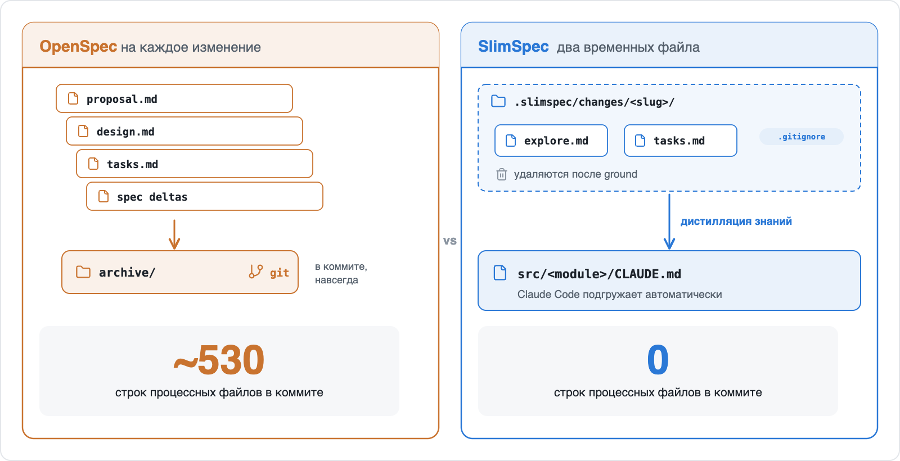
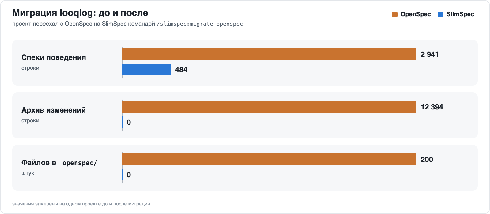
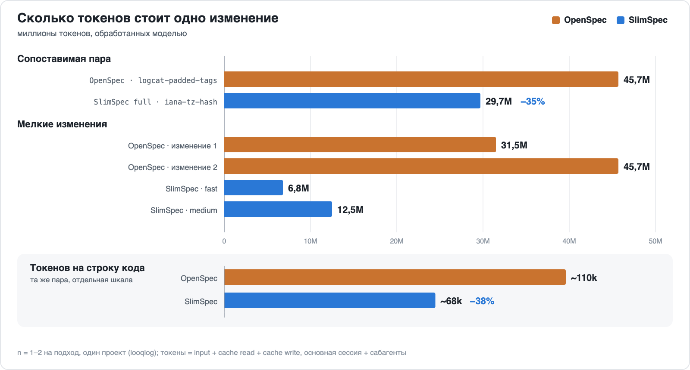
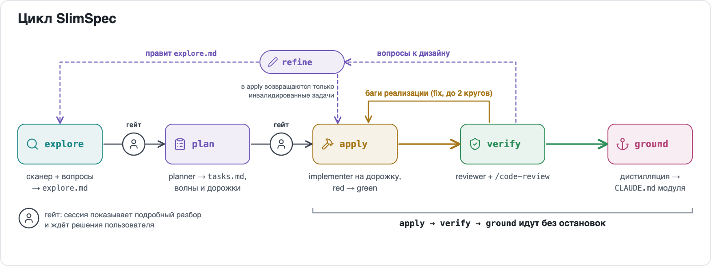
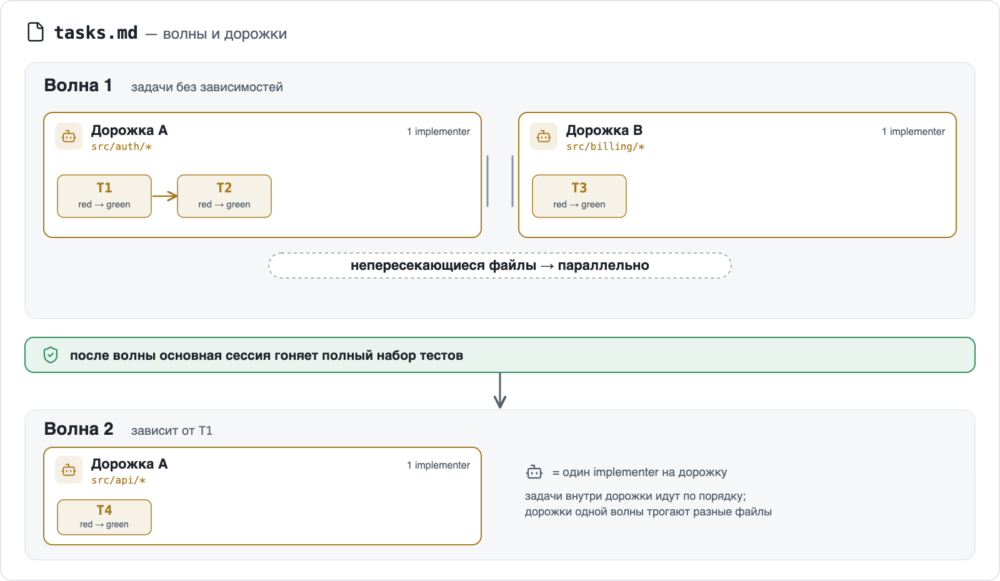
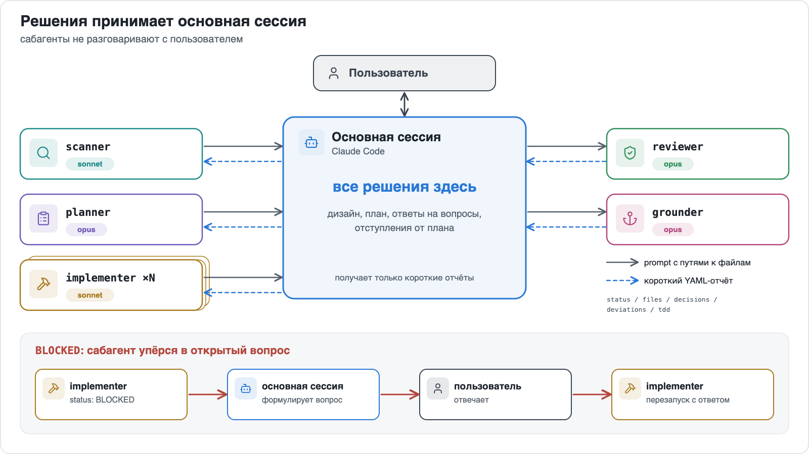
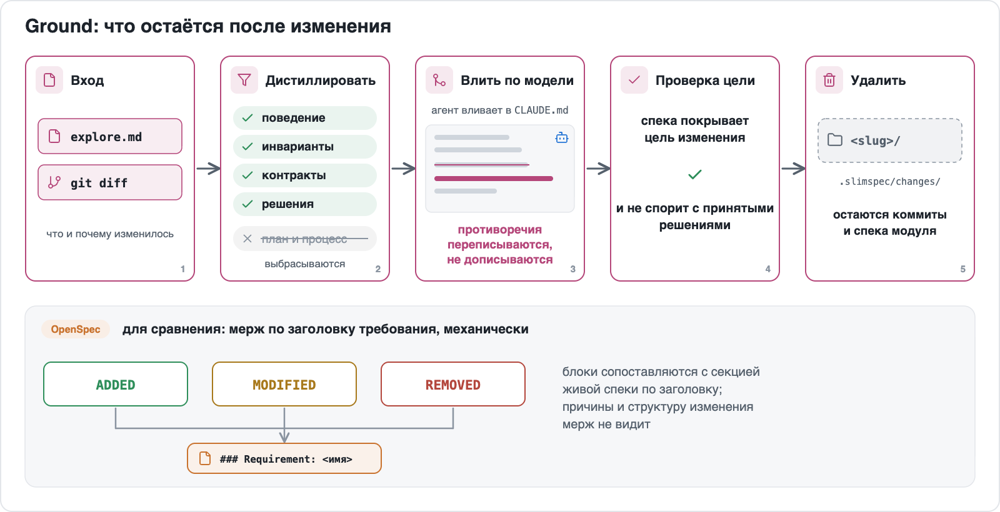

# SlimSpec

Сайт: https://yushman.github.io/slimspec/ru/

[English version](README.md)

## Сильным моделям не нужны тяжёлые спеки.

Агент сам восстанавливает картину, быстро пробежав по коду. Спеке остаётся подсказать ему, что делать и где искать. А explore уже и есть спека изменения.

**SlimSpec** это плагин для Claude Code, построенный на этой идее. Он запускает цикл explore → plan → apply → verify с обязательным red-green TDD. На изменение заводятся два временных файла. У каждого модуля одна компактная спека во вложенном `CLAUDE.md`, который Claude Code подгружает автоматически: где искать и что нельзя сломать, и ничего больше.

Порядок тут обратный привычному SDD: сначала работа, а спека выходит из неё в конце, как стружка из-под рубанка.

## Установка

В Claude Code:

```
/plugin marketplace add yushman/slimspec
/plugin install slimspec@slimspec
```

Дальше: `/slimspec <идея>`

Или подключить локальный клон:

```bash
git clone https://github.com/yushman/slimspec ~/src/slimspec
claude --plugin-dir ~/src/slimspec/plugin
```

Внутри только скиллы и описания агентов. Ни скриптов, ни хуков, ни CLI, так что ломаться тут почти нечему.

## Зачем

Пока модели были послабее, SDD выручал. Контекст тесный, сабагентов нет, и каждая новая сессия открывала проект с лицом стажёра в первый рабочий день. Решение было простое: всё записать, записанное закоммитить, следующей сессии дать почитать. Так появились OpenSpec и Superpowers, и их лучшая находка, дизайн раньше плана, здесь осталась.

А потом попалось изменение в проекте вообще без SDD-фреймворка. Ни proposal, ни design, ни дельт, ни даже `tasks.md`. Модель прочитала код, нашла, что трогать, внесла правку, и правка прошла живое ревью у кодовнера. Ни одна спека при этом не пострадала: их просто не было.

На командном проекте с OpenSpec картина была другая. Корпоративная подписка, несколько терминалов с разными фичами, а процесс всё равно полз:

- После proposal пишутся design, tasks, дельты спек и прочее. Читали их редко. Зато все они коммитились и уезжали в архив: без бумажки ты букашка.
- Любая правка в незаархивированном change рождает ещё один change. Передумали на полпути? Возьмите талончик, как в МФЦ, и ждите своей очереди.
- Перед архивацией обязателен ребейз, а потом агента просят вручную проверить мерж спек: вдруг коллега уже переписал секцию, куда ляжет блок MODIFIED.

Рекорд по бумажной работе поставила задача на удаление. Выпилить ненужный кусок экрана: убрать код, убрать тесты, закрыть тикет. Дифф в итоге такой:


99 файлов, +5218 −5495. Ушло около 5,5 тысячи строк, и почти столько же пришло. Пришли спеки: proposal (зачем удаляем), design (как удаляем), tasks (в каком порядке) и дельты REMOVED (что именно удалили). Чтобы стереть ~5 тысяч строк кода, пришлось написать ~5 тысяч строк спек. Примерно как выносить мусор в сопровождении нотариуса.

В **SlimSpec** дизайном служит сама основная сессия. Вы обсуждаете изменение с агентом, и дизайн с планом складываются прямо в разговоре. Отступления фиксируются там же, нового change не требуется; если доработка разрастается, агент предлагает отправить её в non-goals. Файлы нужны только на случай, если сессия потеряется или её сожмёт компакшн. Это точка сохранения, а не сама игра.



## Замеры на реальном проекте

### Миграция

Один существующий проект, [looqlog](https://github.com/yushman/looqlog), просмотрщик логов на Rust с веб-интерфейсом, перевели с OpenSpec командой `/slimspec:migrate-openspec`. У него было 23 файла спек, 23 изменения в архиве, 200 файлов в `openspec/` и 733 КБ истории. Агенту из этого было нужно немногое, но коллекция, как водится, пополнялась сама. До и после:

|                       | OpenSpec                                    | **SlimSpec**                    |
|-----------------------|---------------------------------------------|-----------------------------|
| Спеки поведения       | 23 файла, 2 941 строка, ~155 КБ             | 3 файла, 484 строки, ~34 КБ |
| Архив изменений       | 23 изменения, 12 394 строки, ~733 КБ        | 0                           |
| Корневой `CLAUDE.md`  | 130 строк                                   | 121 строка                  |
| Файлов в `openspec/`  | 200                                         | 0                           |



### Откуда разница

- Сценарии WHEN/THEN влились в требования, которые они и описывали. Пустые разделы Purpose и шаблонные SHALL ушли (SHALL, SHALL NOT, SHALL ALWAYS: спеки начали звучать как пользовательское соглашение).
- Одна спека на модуль вместо 23 на фичи. Агент читает только спеку модуля, в котором работает: правка в `web/` подтягивает ~11 КБ, а не россыпь capability-файлов по всему дереву.
- Архива изменений в рабочем дереве больше нет. В git-истории того проекта он остался.

### Что потеряно

Гладко было на бумаге, а на деле кое-что пришлось отдать:

- Сценариев как списка тест-кейсов больше нет.
- Обоснования отдельных изменений пропали. Часть сохранилась в ADR, остальное есть только в git-истории, для любителей `git blame` по выходным.
- Самая большая спека модуля (~14 КБ) грузится целиком при любой работе в этом модуле.

Спустя четыре изменения на **SlimSpec** спеки модулей занимают 4 файла и 641 строку, всё ещё на 78% меньше спек OpenSpec, которые они заменили. Рост теперь идёт вслед за кодом, а не за церемониями.

### Стоимость изменения

Тот же проект до и после миграции, замер по транскриптам Claude Code. Токенами здесь считается весь вход, который обработала модель (input + чтение кэша + запись в кэш), основная сессия и субагенты вместе. Самая близкая по размеру пара:

|                                  | OpenSpec (`logcat-padded-tags`) | **SlimSpec** full (`iana-tz-hash`) |
|----------------------------------|---------------------------------|--------------------------------|
| Изменено кода                    | 409 строк, 4 файла, один модуль | 435 строк, 15 файлов, три модуля |
| Обработано токенов               | 45,7M                           | **29,7M (−35%)**               |
| Токенов на строку кода           | ~110k                           | **~68k (−38%)**                |
| Ревью                            | нет                             | **2 раунда verify на глубине high; один реальный блокер (паника на крайних датах) исправлен внутри изменения** |
| Закоммичено процессных файлов    | ~530 строк (proposal, design, tasks, дельты спек, devlog) | **0** (папка изменения удалена; правки спек лежат в `CLAUDE.md` модулей) |
| Общее время, с гейтами           | 91 мин                          | 56 мин                         |



При этом **SlimSpec** сделал больше: 5 вопросов по решениям и 3 гейта, 9 задач в 3 волнах, ground в 4 спеки, ADR и оба README. Блокер, который поймал ревьюер, был паникой на крайних датах. Такие баги тихо сидят в коде, пока календарь не выкинет что-нибудь необычное.

Мелкие изменения показывают то же. Два изменения на OpenSpec обработали 31,5M и 45,7M токенов, два на **SlimSpec** (fast и medium) 6,8M и 12,5M. Один implementer в OpenSpec в одиночку обрабатывал 13–16M токенов, субагент **SlimSpec** 0–1M, потому что каждому достаётся одна узкая дорожка и держать в голове весь репозиторий ему не нужно.

Оговорки сразу: n = 1–2 на подход, один проект. Мелкие изменения на **SlimSpec** были в 5–10 раз меньше по коду, так что часть разницы объясняется размером. Часть агентов **SlimSpec** работала на Sonnet или Haiku. Основная сессия прогона **SlimSpec** full несла посторонний контекст из более ранней работы, что завышает её счёт. Выборка маленькая, разрыв большой: это наблюдение, а не бенчмарк.

## Как идёт работа



`refine` правит `explore.md` и `tasks.md` и отправляет инвалидированные задачи обратно в `apply`. Галя, отмена, но не всего чека, а только задетых позиций. Запускается по замечаниям к дизайну из verify или когда задача в apply упёрлась в ошибку дизайна или плана.

- `explore`: Агент-сканер читает спеки модулей, потом код, и возвращает короткую сводку. Основная сессия задаёт вам вопросы (одно решение на вопрос, независимые вместе) и пишет `explore.md`. К плану сама не переходит. Готовьтесь, что вашей же идее зададут больше неудобных вопросов, чем вы планировали. В этом и смысл.
- `plan`: Планировщик пишет `tasks.md` волнами и делит каждую волну на дорожки из связанных задач. Дорожки одной волны трогают непересекающиеся файлы и идут параллельно. У каждой задачи указан первый падающий тест.
- `apply`: На каждую дорожку свой исполнитель: он проходит её задачи по порядку и по каждой приносит доказательства red и green. Полный набор тестов гоняется после каждой волны, чтобы дорожки, зелёные поодиночке, не сломались вместе незаметно. Если задача упёрлась в дизайн или план (не хватает решения, не те файлы, в задуманном виде не сделать), вопрос приходит к вам через `refine`, и apply продолжает.
- `verify`: Ревьюер сверяет результат с планом и дизайном, проверяет доказательства TDD и сам код. Баги уходят обратно в apply, вопросы к дизайну приходят к вам через `refine`.
- `ground`: Из изменения выделяются долговременные знания (поведение, инварианты, контракты, решения), и модель вливает их в спеки затронутых модулей. Поиск по ключевым словам для слияния не используется. После этого удаляется папка изменения `.slimspec/changes/<slug>/`; `.slimspec/` и конфиг остаются.



Остановок две: после explore и после plan. Каждая остановка начинается с подробного разбора: после explore показывается дизайн с диаграммами, после plan показывается полный план (волны, дорожки, тесты по задачам). Остальные фазы идут без остановок и возвращаются к вам только с вопросами агентов, замечаниями к дизайну или после двух автоматических циклов исправлений. В это время можно заняться чем-нибудь другим.

Все решения принимает основная сессия. Субагенты выполняют работу и возвращают короткий структурированный отчёт: статус, файлы, решения, отступления от плана, red/green. Напрямую они вас ни о чём не спрашивают. Открытый вопрос возвращается как `BLOCKED`, основная сессия задаёт его вам и перезапускает агента с ответом. Отчёт выглядит так, без логов и диффов:

```yaml
status: DONE | BLOCKED | FAILED
task: T3
files: [src/auth/token.ts, src/auth/token.test.ts]
decisions: ["used existing clock abstraction"]
deviations: ["renamed validate → verifyToken"]
tdd:
  red: "token.test.ts: rejects expired token — FAIL (expected 401, got 200)"
  green: "12 passed"
questions: []
```

Простыни тестовых логов в основную сессию не попадают, а каждое решение и каждый итог в ней есть.



Изменение живёт в `.slimspec/changes/<slug>/`: это `explore.md` и `tasks.md`. Папка в `.gitignore` (**SlimSpec** сам добавляет `.slimspec/changes/`) и удаляется после ground. Историю хранят ваши коммиты и обновлённые спеки. Отряд не заметит потери бойца: всё ценное к этому моменту уже в спеках. `/slimspec <slug>` продолжает изменение по его файлам.

Ground ближе всего к классическому SDD. План и процесс выбрасываются: в какой волне шла T3, не понадобится уже никому. Остальное вливает агент, который понимает, зачем делалось изменение. Утверждение, которое противоречит изменению, он переписывает, а не подселяет к нему соседа, иначе спека постепенно превращается в ветку комментариев, спорящую сама с собой. Потом агент проверяет, что обновлённая спека покрывает цель изменения и не спорит с принятыми решениями. Результат ложится во вложенный `CLAUDE.md` модуля, и следующий агент, зайдя в модуль, найдёт спеку уже на месте.



TDD во всех режимах проверяется по свидетельствам red/green; TDD-хука нет. Implementer гоняет только тесты своей задачи; полный набор тестов запускается один раз после каждой волны и ещё раз в verify. Verify не примет задачу без red-прогона, и падать red должен по делу: тест, упавший на отсутствующем импорте, ничего не доказывает. Ты не пройдёшь! Где TDD неприменим (конфиг, стили, миграции), у задачи стоит `test: none — <причина>` и альтернативная проверка, а все такие исключения видны на гейте плана. Затерять «тут тесты не нужны» в середине списка не выйдет.

## Режимы

| Фаза      | fast                               | medium                           | full                                   |
|-----------|------------------------------------|----------------------------------|----------------------------------------|
| `explore` | inline, ≤3 вопросов, вместе с plan | scanner + grilling               | то же + явный гейт на `explore.md`     |
| `plan`    | секция внутри `explore.md`         | агент planner, волны из дорожек  | то же + полный `tasks.md` на гейте     |
| `apply`   | один implementer, TDD              | по implementer на дорожку        | то же                                  |
| `verify`  | reviewer, глубина `low`            | reviewer, глубина `medium`       | reviewer, глубина `high`               |
| `ground`  | обновить затронутые спеки          | дистилляция + проверка намерения | то же                                  |

`fast` подходит для правки в одну строку, на которую стыдно писать proposal. `full` для изменения, на которое хочется вторую пару глаз. Не хотите выбирать? `/slimspec` предложит режим после скана.

Planner делит каждую волну на дорожки из связанных задач с непересекающимися файлами. Apply запускает по implementer на дорожку, до `apply.agents` параллельно, и каждый проходит свои задачи по порядку.

```
/slimspec <идея>          # режим из конфига, предлагается после скана
/slimspec:fast <идея>     # фиксированный режим, без предложения
/slimspec:medium <идея>
/slimspec:full <идея>
/slimspec                 # активные изменения: продолжить или отменить
```

Каждую фазу можно вызвать и отдельно: `/slimspec:explore`, `/slimspec:plan`, `/slimspec:apply`, `/slimspec:verify`, `/slimspec:refine`, `/slimspec:ground`.

## OpenSpec, Superpowers и SlimSpec

**SlimSpec** использует части обоих инструментов: дизайн раньше плана у обоих и слияние спек, после которого остаётся только важное, у OpenSpec. В таблице перечислено только то, в чём **SlimSpec** отличается; жирным в колонке **SlimSpec** выделено, в чём он лучше.

|                      | OpenSpec | Superpowers | **SlimSpec** |
|----------------------|----------|-------------|----------|
| Цикл                 | explore → propose → apply → verify → archive, на каждый шаг своя команда; explore и verify необязательны | brainstorming → worktree → plan → execute → завершение ветки; скиллы срабатывают сами | **Одна команда, две остановки.** Ведёт от explore до ground, вы останавливаетесь на двух гейтах; verify не пропускается |
| Explore              | `/opsx:explore`, необязательный собеседник «подумать» перед proposal | brainstorming; когда дизайн проекта одобрен, следующим шагом идёт план | **Explore и есть спека изменения.** Вопросы по одному решению записываются в `explore.md` (цель, не-цели, решения, риски); отдельных proposal и design нет |
| Артефакты изменения  | proposal, design, tasks, дельты спек; потом папка уезжает в архив в репозитории | для проекта: дизайн-документ с датой в `docs/superpowers/specs/` (коммитится) и план в `docs/superpowers/plans/`; мелкие правки согласуются в чате | **В коммит идут только код и правки спек.** `explore.md` + `tasks.md`, в `.gitignore`, удаляются после ground |
| Живая спека          | файл на capability в `openspec/specs/`, агент читает, когда вы на него укажете | нет; на проект один дизайн-документ | **Грузится сама и только там, где вы работаете.** Одна спека на модуль во вложенном `CLAUDE.md` |
| Слияние спек         | секции ADDED / MODIFIED / REMOVED применяются к основной спеке по требованиям при архивации | в живую спеку ничего не сливается | **Слияние по смыслу.** Модель переписывает противоречия и сверяет результат с намерением изменения |
| Субагенты            | встроенного механизма нет | свежий субагент на каждую задачу и ревью после неё, либо выполнение в той же сессии | **Узкие агенты, дешёвый контекст.** Scanner, planner, параллельные implementer по дорожкам, reviewer, grounder, у каждого своя модель; вопросы поднимаются к вам |
| Замеренная стоимость | 45,7M токенов на изменение ~400 строк | не замерялась | **29,7M токенов на сопоставимое изменение, с двумя раундами ревью** |

**Чего нет в SlimSpec.** У OpenSpec сценарии остаются явными тест-кейсами, рядом со спеками лежит полная история всех изменений, и он работает с 30+ AI-инструментами. В Superpowers есть скиллы помимо работы со спеками (отладка, worktree, код-ревью и другие), и он поддерживает многих агентов. **SlimSpec** работает только с Claude Code и покрывает только spec-driven цикл. Он крутит один цикл и держится своей дорожки.

## Переезд с OpenSpec или Superpowers

```
/slimspec:migrate-openspec     # openspec/specs/ → спеки модулей
/slimspec:migrate-superpowers  # дизайн-документы Superpowers → спеки модулей
```

- Переносятся только спеки. Каждая спека источника привязывается к модулям, сжимается в ваш `spec.format` и сверяется с кодом.
- Сначала вы подтверждаете таблицу «источник → спека» и решаете по каждому утверждению, с которым расходится код. Ошибаться может любая сторона, и выбирать победителя за вас инструмент не станет.
- Изменения, планы и служебные файлы не конвертируются. Удаляются они только на финальном шаге очистки и только то, что вы подтвердите. Код не трогается.
- Сам плагин Superpowers удаляется через `/plugin uninstall`.

## Конфиг

Конфиг необязателен: у каждого ключа есть значение по умолчанию, и если настраивать ничего не хочется, можно не настраивать. `/slimspec:init` задаёт несколько вопросов в сессии и записывает `.slimspec/config.yaml`:

```yaml
mode: medium              # fast | medium | full
spec:
  format: claude-md       # claude-md | readme | central | native | none
  unit: auto              # auto (по билд-файлам) | glob директорий, напр. "src/*/"
  adr: false              # дополнительно вести решения в docs/adr/NNNN-*.md
test: auto                # или явная команда
commit: none              # none | lane | wave
apply:
  agents: 3               # максимум параллельных implementer = максимум дорожек в волне
review:
  depth: auto             # auto (по режиму) | low | medium | high
models: {}                # переопределения по ролям, см. ниже
```

`models` задаёт модель агента каждой фазы, ключ — роль: `haiku | sonnet | opus`. Неуказанные ключи остаются по умолчанию.

| Фаза | Роль (ключ `models`) | По умолчанию |
|---|---|---|
| explore (medium, full) | `scanner` | sonnet |
| plan (medium, full) | `planner` | opus |
| refine (структурное перепланирование, medium, full) | `planner` | opus |
| apply | `implementer` | sonnet |
| verify | `reviewer` | opus |
| ground | `grounder` | opus |

Вопросы, гейты, разбор замечаний и остальная часть refine идут в основной сессии, на модели вашей сессии. В `fast` там же, без агентов, идут explore и plan.

```yaml
models:
  implementer: opus       # код сложнее обычного
  scanner: haiku          # небольшой репозиторий с хорошими спеками
```

Дорогим моделям достаётся думать, дешёвым печатать. При `commit: lane` или `wave` коммитит только основная сессия, агенты никогда. **SlimSpec** никогда не пушит, и это не недоделка.

---

[GitHub](https://github.com/yushman/slimspec) · [Дизайн и решения (англ.)](DESIGN.md) · [Лицензия MIT](LICENSE)
